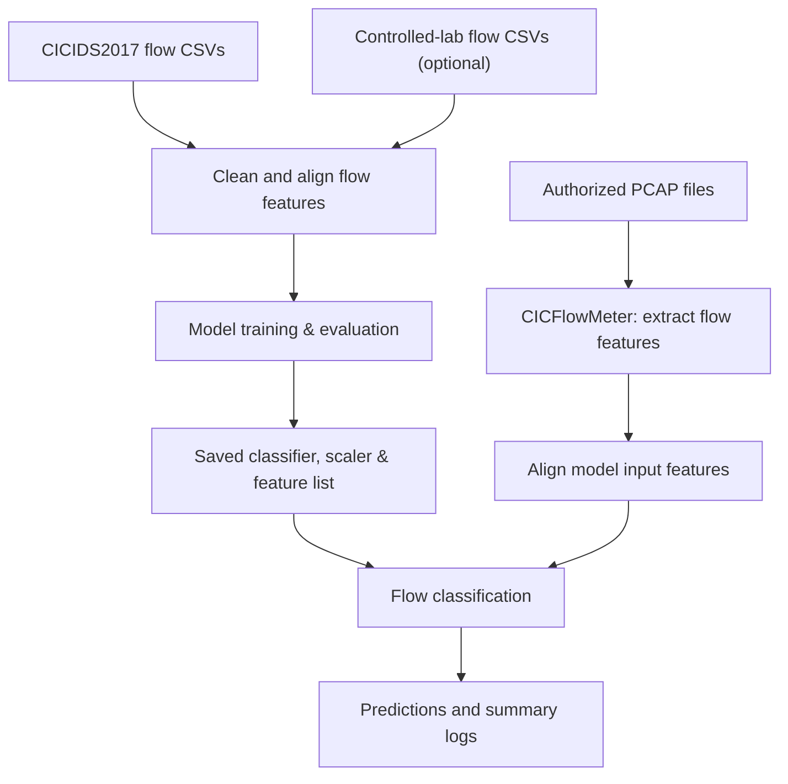

# Machine Learning-Based Network Intrusion Detection System

**BSc thesis project | Python · scikit-learn · Network Traffic Analysis · CICIDS2017**

A research prototype for classifying **network flows as benign or attack traffic** with supervised machine learning. The project compares four classifiers on CICIDS2017 and explores a local, PCAP-based inference workflow using CICFlowMeter and traffic from a controlled virtual lab.

> **Project status:** Thesis / research prototype, not a production-ready IDS. The training and live-pipeline scripts still contain environment-specific path settings, and the repository does not include the original datasets or trained models. See [Running the project](#running-the-project) and [Limitations](#limitations-and-future-work).

## What this project demonstrates

- Preprocessing and aligning CICIDS2017 flow features for binary classification.
- Comparing **Decision Tree, Random Forest, linear SVM (LinearSVC), and neural network (scikit-learn MLPClassifier)** models.
- Evaluating precision, recall, F1, accuracy, and confusion matrices.
- Preparing additional benign and attack-labeled flow data collected in a controlled Kali Linux / Ubuntu lab.
- A proof-of-concept **PCAP → CICFlowMeter → feature alignment → model inference → CSV/log output** workflow.
- Python-based experimentation with pandas, NumPy, scikit-learn, joblib, and Docker environment setup.

## System overview



The Python scripts in `src/` implement these stages. The live pipeline expects a separate installation of CICFlowMeter and local capture files; it does not capture traffic from external networks by itself.

## Reported benchmark results

Results below are taken directly from the repository's [`results/model_comparison_results.csv`](results/model_comparison_results.csv). Values are rounded to two decimal places.

| Classifier | Accuracy | Precision (attack) | Recall (attack) | F1 (attack) |
| --- | ---: | ---: | ---: | ---: |
| Random Forest | 99.88% | 99.67% | 99.72% | **99.69%** |
| Decision Tree | 99.69% | 98.65% | 99.80% | 99.22% |
| Neural Network (MLP) | 99.20% | 97.66% | 98.23% | 97.95% |
| Linear SVM | 93.18% | 75.53% | 96.27% | 84.65% |

A separate experiment with additional custom-flow data reports **99.70% F1** for its Random Forest model in [`results/model_comparison_results_improved.csv`](results/model_comparison_results_improved.csv). It is a different experiment; the figures should not be interpreted as a proven production improvement or independently validated real-world detection rate.

### Evaluation notes

- `src/train_ids.py` specifies a **stratified 80/20 train/test split**, with `random_state=42`.
- Its default configuration samples **up to 200,000 records** from the preprocessed dataset before splitting. The original CICIDS2017 dataset is larger; a benchmark score is not evidence that all original records were used for training.
- The positive class is **attack (1)** and the negative class is **benign (0)**.
- The stored result CSVs report accuracy, precision, recall, F1, and training duration. They **do not contain confusion-matrix counts, false-positive rates, or an independently held-out live-traffic evaluation**.
- Random splits of related network flows can overestimate generalization. A stronger follow-up evaluation would use disjoint capture sessions or temporal splits, report per-attack-class breakdowns, and test on traffic from a separate environment.

These are **saved experimental results**, not independent reproduction or performance guarantees.

## Repository layout

```text
.
├── src/
│   ├── prepare_dataset.py          # CICIDS2017 CSV cleaning and binary labels
│   ├── train_ids.py                # Baseline model comparison
│   ├── prepare_custom_dataset.py   # Custom lab-flow preparation
│   ├── train_ids_improved.py       # Experiment combining CICIDS + custom flows
│   ├── live_detector.py            # Watches flow CSVs and classifies them
│   └── live_pipeline_improved.py   # PCAP -> CICFlowMeter -> inference workflow
├── results/
│   ├── model_comparison_results.csv
│   ├── model_comparison_results_improved.csv
│   └── training_feature_columns_improved.csv
├── thesis/
│   └── Intrusion_Detection_System_IDS_using_Machine_Learning.pdf
├── Dockerfile
├── requirements.txt
└── README.md
```

## Running the project

**Important:** These instructions describe the current scripts; setup is not yet fully automated. The code was developed around local Windows directories, so you must configure file paths before running it on another machine.

### 1. Set up Python dependencies

Use Python 3.11 (the version in the Dockerfile), clone this repository, and create a local environment:

```bash
git clone https://github.com/Rahmi-serag/machine-learning-ids.git
cd machine-learning-ids
python -m venv .venv
# Activate .venv using your operating system's normal activation command.
python -m pip install -r requirements.txt
```

The dependencies in `requirements.txt` are **not pinned**; results may vary across package versions. The Dockerfile installs a Python environment but does **not** package the trained model, datasets, CICFlowMeter, or an automatically running detector.

### 2. Provide the data and configure local paths

1. Obtain the **CICIDS2017 flow CSVs** from an authorized source. The large raw data files are intentionally not committed.
2. In `src/prepare_dataset.py`, update `BASE_DIR` to a directory you control and place the CSVs under `BASE_DIR/data/raw_cicids2017/`.
3. In `src/train_ids.py`, set the same `BASE_DIR`. The preprocessing script writes `data/processed/cicids2017_binary.csv` under it.
4. The custom-data and improved-training scripts have **additional configuration and path assumptions**; review their file-header settings before using them.

### 3. Preprocess and train the baseline models

After updating the paths and providing the required input data:

```bash
python src/prepare_dataset.py
python src/train_ids.py
```

Training writes model/scaler artifacts to the configured `models/` directory and reports, confusion-matrix images, and metrics to `results/`. These commands are **not verified as a clean-environment installation test**.

### 4. Optional flow inference in an authorized lab

- `src/live_detector.py` watches a configured folder of **flow CSV files** and uses the trained Random Forest model, scaler, and feature list.
- `src/live_pipeline_improved.py` watches a configured folder of **PCAP files**, invokes an externally installed **CICFlowMeter**, then writes classifications and summary logs.
- Both scripts currently refer to Windows-specific locations and require saved model artifacts. The PCAP pipeline also requires configuring `CICFLOWMETER_BAT` and the watched input/output folders.

Use only traffic you own or are authorized to analyze. The documented pipeline is a laboratory demonstration, not a replacement for validated monitoring or an incident-response system.

## Limitations and future work

- **Portability:** Replace machine-specific paths with a shared configuration file or CLI arguments.
- **Reproducibility:** Pin dependency versions, document dataset release/partitions, and add smoke tests and CI.
- **Evaluation:** Publish confusion matrices, false-positive counts with denominators, repeated-run variance, and leakage-resistant evaluation.
- **Deployment:** Containerize the complete inference workflow; the current Dockerfile is an environment scaffold only.
- **Robustness:** Investigate missing-feature imputation, class imbalance, drift, and behavior on unseen traffic.
- **Security/privacy:** Keep raw traffic captures, private lab addresses, credentials, and sensitive logs out of version control.

## Thesis and author

The accompanying [BSc thesis](thesis/Intrusion_Detection_System_IDS_using_Machine_Learning.pdf) contains more project background.

**Serag Rahmi** · [GitHub](https://github.com/Rahmi-serag)

This repository is intended for educational and defensive research.
